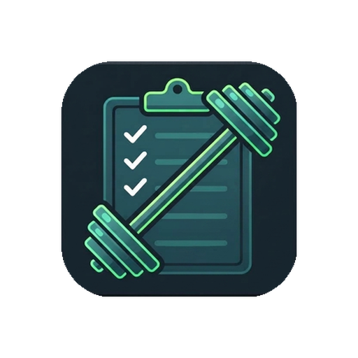

<div align="center">

  

  # 🏋️‍♂️ GymPlanner
  **اپلیکیشن مدرن، هوشمند و کاملاً آفلاین برنامه‌ریزی تمرینی و ردیابی پیشرفت ورزشی**
  
  *Modern, Tactile, and Offline-First Workout Planner & Fitness Tracker for Android*

  <br />

  [-3DDC84?style=for-the-badge&logo=android&logoColor=white)](https://developer.android.com)
  [](https://kotlinlang.org)
  [](https://developer.android.com/jetpack/compose)
  [](https://developer.android.com/topic/architecture)
  [](https://developer.android.com/training/data-storage/room)
  [](LICENSE)
  [](https://github.com/NariManoV21/GymPlanner/releases/latest)

  <br />

  <p align="center">
    <a href="#-ویژگیهای-کلیدی-key-features">✨ ویژگی‌ها</a> •
    <a href="#-معماری-نرم‌افزار-architecture">🏛 معماری</a> •
    <a href="#-امنیت-و-حریم-خصوصی-security--privacy">🔒 امنیت</a> •
    <a href="#-راهنمای-نصب-و-دانلود-installation--download">📦 دانلود و نصب</a> •
    <a href="#-تکنولوژیها-tech-stack">🛠 تکنولوژی‌ها</a>
  </p>

</div>

---

## 📖 معرفی اپلیکیشن | Overview

**GymPlanner** یک اپلیکیشن تمرینی پیشرفته، مدرن و با طراحی ارگونومیک (Tactile Design) برای ورزشکاران است که بدون نیاز به اتصال به اینترنت، مدیریت کامل جلسات تمرینی، برنامه‌ریزی هفتگی، ثبت رکوردهای وزنی، آنالیز شاخص توده بدنی (BMI) و استراحت بین ست‌ها را در اختیار شما قرار می‌دهد.

این پروژه با ترکیب **Jetpack Compose Material 3** و انیمیشن‌های پویا، موشن‌گرافیک سه‌بعدی اختصاصی، و سیستم تور تعاملی نورافکنی (Spotlight Tour) به سبک دولینگو، تجربه‌ای بسیار لذت‌بخش و روان را برای ورزشکاران فراهم می‌سازد.

---

## ✨ ویژگی‌های کلیدی | Key Features

| ردیف | قابلیت | توضیحات فارسی | English Description |
| :---: | :--- | :--- | :--- |
| **۱** | **🎬 موشن گرافیک ۳ بعدی اسپلش** | انیمیشن آغازین سه‌بعدی نرم و روان با قلم منفرد، مسیر حرکتی بزیه و رنگ‌آمیزی همگام نوار پیشرفت | 3D motion graphic splash screen with single detachable stylus and lockstep progress loading |
| **۲** | **💡 تور نورافکنی پویا (سبک دولینگو)** | معرفی مرحله‌به‌مرحله بخش‌ها با تیره کردن پس‌زمینه، برش شفاف دکمه‌ها، حاشیه نئونی ضربانی و فلش اشاره‌گر | Duolingo-style dynamic spotlight coachmark walkthrough over live app screens with directional pointers |
| **۳** | **📅 تقویم هوشمند شمسی و میلادی** | تقویم ماهانه آکاردئونی با الگوریتم دقیق تبدیل ریاضی هجری شمسی و نوار افقی ۷ روز هفته با تمرکز عضلانی | Interactive Persian Hijri Shamsi & Gregorian expandable monthly calendar with 7-day muscle group planner |
| **۴** | **🏋️‍♂️ برنامه‌ریزی و اجرای زنده تمرین** | تعریف ست‌ها، وزنه‌ها، تکرارها، زمان و مسافت با قابلیت تیک زدن ست‌به‌ست حین اجرای زنده تمرین | Comprehensive exercise manager supporting sets, reps, weight, duration, distance, and live set check-offs |
| **۵** | **⏱️ تایمر هوشمند استراحت بین ست‌ها** | شمارش معکوس خودکار زمان استراحت بین ست‌های تمرینی همراه با محاسبه تناژ کل جلسه تمرین | Smart automatic rest timer between workout sets with live volume & total tonnage calculator |
| **۶** | **📈 نمودار وزن و شاخص توده بدنی (BMI)** | رسم هوشمند منحنی تغییرات وزن با برچسب‌های تقویم شمسی، محاسبه خودکار BMI و تسلسل تمرینی (Streak 🔥) | Weight progress curve chart with Persian date points, automated BMI calculation, and workout streaks |
| **۷** | **🎨 سیستم تم لمسی و ارگونومیک** | طراحی مدرن با داک ناوبری شناور، فیزیک لمسی ارتجاعی و پشتیبانی از تم‌های تیره (Dark) و روشن (Light) | Tactile UI design system featuring spring physics, elastic capsules, and Dark/Light themes |
| **۸** | **🌐 دو زبانه و فرمت‌بندی بومی** | پشتیبانی لحظه‌ای از دو زبان فارسی و انگلیسی همراه با تبدیل خودکار تمامی ارقام به خط فارسی | Seamless bilingual engine (Persian / English) with automatic Persian digit formatting |
| **۹** | **💾 پشتیبان‌گیری و بازگردانی داده‌ها** | استخراج و بارگذاری آسان فایل پشتیبان JSON برای حفظ داده‌ها در هر شرایطی | Local JSON backup export and import for hassle-free data portability |

---

## 🏛 معماری نرم‌افزار | Architecture

پروژه بر پایه اصول **Clean Architecture** و الگوی واکنشی **MVI / MVVM** پیاده‌سازی شده است تا حداکثر تفکیک وظایف (Separation of Concerns)، تست‌پذیری و انعطاف حاصل شود.

```mermaid
graph TD
    subgraph UI Layer (Jetpack Compose & Custom Canvas)
        A[MainActivity] --> B[GymPlannerApp]
        B --> C1[HomeScreen - داشبورد و وضعیت امروز]
        B --> C2[PlannerScreen - برنامه‌ریز هفتگی و تقویم شمسی]
        B --> C3[ReportScreen - نمودار پیشرفت وزن و شاخص BMI]
        B --> C4[ActiveWorkoutScreen - جلسه تمرین زنده و تایمر]
        B --> C5[SettingsScreen - تنظیمات زبان، تم و بکاپ]
        B --> C6[SpotlightTourOverlay - تور تعاملی دولینگو]
    end

    subgraph Presentation & State
        D[GymPlannerViewModel] -->|StateFlow&lt;GymPlannerUiState&gt;| B
    end

    subgraph Data Layer
        D --> E[GymPlannerRepository]
        E --> F1[(Room SQLite Database)]
        E --> F2[Jetpack DataStore Preferences]
        E --> F3[Backup & Restore Manager]
    end
```

---

## 🔒 امنیت و حریم خصوصی | Security & Privacy

این پروژه ممیزی امنیتی جامع را با موفقیت پشت سر گذاشته است:

- **۱۰۰٪ آفلاین و محلی (Offline-First):** هیچ داده، رکورد بدنی یا تاریخچه ورزشی به اینترنت ارسال نمی‌شود.
- **عدم نشت اطلاعات حساس (Zero Secrets Leak):** در تمامی سورس‌کدها، فایل‌های مانیفست و اسکریپت‌های پروژه هیچ‌گونه کلید API، توکن یا رمزی وجود ندارد.
- **ایزولاسیون مانیفست (`AndroidManifest.xml`):** تنها اکتیویتی `MainActivity` در حالت لاغر (Lean) برای لانچر در دسترس است؛ هیچ BroadcastReceiver، ContentProvider یا سرویس بازی که در معرض سوءاستفاده باشد تعریف نشده است.
- **سندباکس پایگاه داده:** دیتابیس محلی در حافظه امن داخلی اپلیکیشن (`getDatabasePath`) ذخیره می‌شود و سایر برنامه‌ها به آن دسترسی ندارند.

---

## 🛠 تکنولوژی‌ها | Tech Stack

| بخش | تکنولوژی / کتابخانه | هدف و کاربرد |
| :--- | :--- | :--- |
| **Language** | Kotlin 2.0+ | زبان مدرن، ایمن و رسمی توسعه اندروید |
| **UI Framework** | Jetpack Compose | فریم‌ورک مدرن و اعلانی (Declarative) رابط کاربری |
| **Design System** | Material Design 3 | سیستم طراحی مدرن با پالت رنگی نئونی ارگونومیک |
| **Local Database** | Room (SQLite) 2.6+ | ذخیره‌سازی آفلاین تمرینات، روزها و رکوردها |
| **Preferences** | Jetpack DataStore | ذخیره تنظیمات کاربر، تم، زبان و پرچم وضعیت تور |
| **Calendar Math** | PersianDateHelper | موتور ریاضی اختصاصی تبدیل تاریخ شمسی و میلادی |
| **Testing** | JUnit 4, Robolectric, Roborazzi | تست‌های واحد، تست‌های ران‌تایم و تست اسکرین‌شات |
| **CI/CD** | GitHub Actions | بیلد اتوماتیک و انتشار فایل APK با هر تگ رلیز |

---

## 📦 راهنمای نصب و دانلود | Installation & Download

### ۱. دانلود مستقیم نسخه نصبی (APK):
شما می‌توانید آخرین نسخه کامپایل‌شده اپلیکیشن را مستقیماً از بخش رلیزهای گیت‌هاب دریافت کنید:
👉 **[دانلود فایل GymPlanner-v1.0.0.apk از بخش Releases](https://github.com/NariManoV21/GymPlanner/releases/latest)**

### ۲. بیلد از طریق سورس‌کد (Build from Source):
برای کامپایل محلی در Android Studio یا از طریق ترمینال:

```bash
# ۱. کلون کردن ریپازیتوری
git clone https://github.com/NariManoV21/GymPlanner.git
cd GymPlanner

# ۲. اجرای تست‌های یونیت
./gradlew testDebugUnitTest

# ۳. بیلد فایل نصبی APK
./gradlew assembleDebug
```
فایل APK تولید شده در مسیر زیر قرار خواهد گرفت:
`app/build/outputs/apk/debug/app-debug.apk`

---

## 📄 لایسنس | License

این پروژه تحت مجوز [MIT License](LICENSE) منتشر شده است. استفاده، ویرایش و بازتوزیع آن کاملاً آزاد است.

<div align="center">
  <sub>ساخته‌شده با ❤️ برای جامعه ورزشکاران و توسعه‌دهندگان</sub>
</div>
