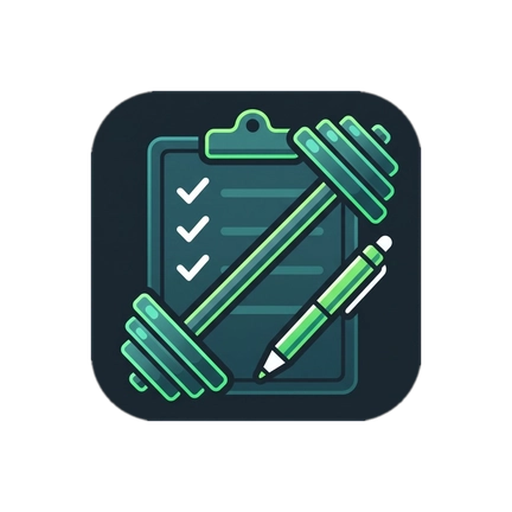
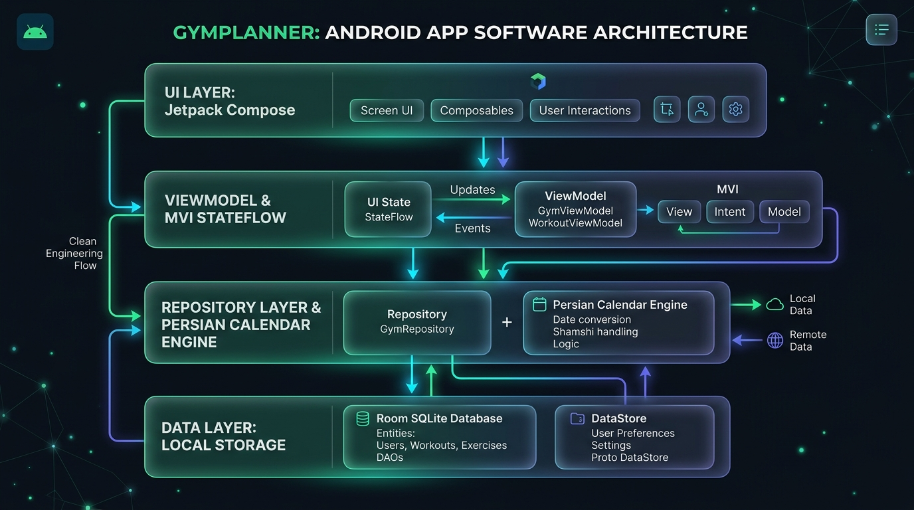

<div align="center">

  


  # 🏋️‍♂️ GymPlanner
  ### اپلیکیشن هوشمند، مدرن و کاملاً آفلاین برنامه‌ریزی تمرینات ورزشی و بدنسازی
  *Modern, Tactile & Offline-First Workout Planner for Android*

  <br />

  [-3DDC84?style=for-the-badge&logo=android&logoColor=white)](https://developer.android.com)
  [](https://kotlinlang.org)
  [](https://developer.android.com/jetpack/compose)
  [](https://developer.android.com/topic/architecture)
  [](https://developer.android.com/training/data-storage/room)
  [](LICENSE)
  [](https://github.com/NariManoV21/GymPlanner/releases/tag/v1.1.0)

</div>

<br />

> ### 🕊️ یادبود و تقدیم
> <div dir="rtl" align="right">
> 
> **این اثر با تمام احترام و مهر، تقدیم می‌شود به یاد و خاطره جاودان دوست خوب و عزیزمان «مهرشاد»** 🖤  
> 
> رفتنت اندوهی بزرگ بر جای گذاشت، اما نام و یاد زیبایت همواره در قلب ما زنده خواهد ماند. تمامی مراحل طراحی، توسعه و به ثمر نشستن این اپلیکیشن با خاطرات فراموش‌نشدنی تو همراه بوده است.  
> 
> *Dedicated with love and sorrow to the eternal memory of our dear friend, Mehrshad.*
> </div>

---

<div dir="rtl" align="right">

## 📖 معرفی اپلیکیشن

**GymPlanner** یک برنامه جامع، ارگونومیک و کاملاً آفلاین برای ورزشکاران و علاقه‌مندان به بدنسازی است. این برنامه طراحی شده تا بدون نیاز به اینترنت یا اشتراک ماهانه، صفر تا صد مدیریت تمرینات، تنظیم برنامه‌های هفتگی، ثبت پیشرفت وزنی و تحلیل شاخص توده بدنی (BMI) را در بستری فوق‌العاده سریع، امن و چشم‌نواز ارائه دهد.

### 🌟 تمایزهای کلیدی تجربه کاربری:
- **موشن گرافیک اختصاصی ۳ بعدی (SplashScreen):** انیمیشن آغازین با کیفیت بسیار بالا، تفکیک قلم منفرد، حرکت روی مسیر قوسی نرم و رنگ‌آمیزی همگام نوار پیشرفت.
- **تور آموزشی زنده سبک دولینگو (Spotlight Tour):** معرفی قابلیت‌ها با برش نوری المان‌ها روی صفحات زنده، حاشیه ضربانی نئونی و بالون راهنمای اشاره‌گر.
- **تقویم کامل شمسی و میلادی:** مجهز به موتور محاسباتی دقیق هجری شمسی، تقویم ماهانه آکاردئونی و نوار افقی ۷ روز هفته با امکان ثبت تمرکز عضلانی هر روز.
- **ثبت ست‌به‌ست حین تمرین زنده:** تیک زدن ست‌ها، محاسبه تناژ وزنی کل، و تایمر هوشمند استراحت با شمارش معکوس خودکار.
- **روند تغییرات وزن و محاسبه شاخص BMI:** نمودار تحلیلی با تاریخ‌های شمسی و سیستم حفظ انگیزه تسلسل تمرین (Streak).
- **سیستم طراحی اختصاصی (Tactile Design):** انیمیشن‌های ترنزیشن الاستیک، داک ناوبری شناور و دو تم تیره (Dark) و روشن (Light).
- **پشتیبانی دو زبانه کامل:** زبان‌های فارسی و انگلیسی با فرمت‌بندی اعداد به خط فارسی.

</div>

---

## ✨ جدول قابلیت‌ها و امکانات

| ردیف | بخش | شرح قابلیت به فارسی | English Description |
| :---: | :--- | :--- | :--- |
| **۱** | **اسپلش اسکرین ۳ بعدی** | انیمیشن موشن لوگوی اصلی، بلند شدن قلم منفرد و لودینگ همگام | 3D Motion splash with single detachable stylus and lockstep loading |
| **۲** | **تور آموزشی دولینگو** | تور نورافکنی زنده، تاریک‌سازی پس‌زمینه و فلش‌های اشاره‌گر هوشمند | Dynamic spotlight coachmark tour over live screens with directional arrows |
| **۳** | **تقویم شمسی هوشمند** | تقویم ماهانه بازشونده، محاسبات ریاضی دقیق هجری شمسی و نوار ۷ روزه | Smart Persian Hijri Shamsi & Gregorian monthly calendar + 7-day bar |
| **۴** | **برنامه‌ریزی تمرینات** | تفکیک تمرینات بر اساس ست، تکرار، وزنه، زمان، مسافت و یادداشت | Complete workout planner supporting sets, reps, weight, duration & notes |
| **۵** | **تمرین زنده و تایمر** | محیط اختصاصی تمرین با ثبت زنده ست‌ها و تایمر هوشمند استراحت | Live active workout tracker with auto-countdown rest timer & tonnage |
| **۶** | **آنالیز وزن و شاخص BMI** | نمودار پیشرفت تغییرات وزن، محاسبه هوشمند BMI و روزهای متوالی تمرین | Weight trend analytics, smart BMI calculator, and workout streaks |
| **۷** | **طراحی ارگونومیک (Tactile)** | داک ناوبری شناور، فیزیک فنری و پشتیبانی از تم‌های تیره و روشن | Tactile design system with spring physics, rubber-band tabs & dark/light themes |
| **۸** | **پشتیبانی دو زبانه** | زبان‌های فارسی و انگلیسی همراه با ارقام و تاریخ‌های استاندارد بومی | Full bilingual support (Persian / English) with native localized digits |
| **۹** | **بکاپ محلی و آفلاین** | استخراج و بارگذاری آسان فایل پشتیبان JSON بدون وابستگی ابری | Offline JSON backup export & import for full data ownership |

---

<div dir="rtl" align="right">

## 🏛 معماری نرم‌افزار (Software Architecture)

پروژه با به‌کارگیری اصول پیشرفته **Clean Architecture** و الگوی واکنشی **MVI / MVVM** در بستری کاملاً ماژولار و تفکیک‌شده طراحی گردیده است:

</div>

<br />

<div align="center">
  
</div>

<br />

<div dir="rtl" align="right">

### لایه‌بندی معماری:
1. **لایه‌ی رابط کاربری (UI Layer):** پیاده‌سازی شده با Jetpack Compose Material 3، شامل صفحات خانه، برنامه‌ریز، گزارش، تمرین زنده و تور دولینگو به همراه موشن گرافیک ۳ بعدی.
2. **لایه‌ی وضعیت و منطق ارائه (ViewModel & MVI StateFlow):** مدیریت تک‌مسیره جریان داده با `StateFlow`، پردازش رویدادهای کاربر و انتشار وضعیت یکپارچه `GymPlannerUiState`.
3. **لایه‌ی دامنه و مخزن (Domain & Repository):** متمرکزسازی منطق برنامه در `GymPlannerRepository` به همراه موتور محاسباتی تاریخ هجری شمسی (`PersianDateHelper`).
4. **لایه‌ی داده و ذخیره‌سازی محلی (Local Storage Data Layer):** پایگاه داده محلی ۱۰۰٪ آفلاین Room SQLite و ذخیره‌ساز تنظیمات DataStore بدون هیچ وابستگی ابری.

</div>

---

<div dir="rtl" align="right">

## 🔒 امنیت و حریم خصوصی

- **۱۰۰٪ آفلاین و محلی (Offline-First):** اطلاعات بدنی و ورزشی شما کاملاً خصوصی بوده و هیچ داده‌ای به هیچ سروری ارسال نمی‌گردد.
- **فاقد دسترسی‌های غیرضروری:** در فایل `AndroidManifest.xml` هیچ‌گونه دسترسی مشکوک، سرویس پشت صحنه بدون محافظت یا رسیور باز وجود ندارد.
- **ایزولاسیون کامل دیتابیس:** پایگاه داده در حافظه امن و سندباکس خصوصی اپلیکیشن ذخیره شده و برای سایر برنامه‌ها غیرقابل دسترس است.
- **امنیت سورس‌کد:** هیچ کلید شخصی، توکن یا رمزی در کدها و کامیت‌های پروژه وجود ندارد.

</div>

---

## 🛠 مشخصات و پشته فنی (Tech Stack)

| حوزه | تکنولوژی | توضیحات |
| :--- | :--- | :--- |
| **Language** | Kotlin 2.1.10 | زبان رسمی و مدرن توسعه اندروید |
| **UI Toolkit** | Jetpack Compose Material 3 | رابط کاربری اعلانی مدرن با انیمیشن‌های روان |
| **Local Database** | Room SQLite 2.6+ | ذخیره‌سازی پایدار و ساختاریافته محلی |
| **DataStore** | Jetpack DataStore Preferences | مدیریت واکنش‌گرای تنظیمات و وضعیت‌ها |
| **Calendar Engine** | PersianDateHelper | موتور ریاضی تبدیل تاریخ هجری شمسی و میلادی |
| **Build System** | Gradle 8.9.1 / AGP 8.9.1 | سیستم بیلد و مدیریت وابستگی‌ها |

---

<div dir="rtl" align="right">

## 📦 راهنمای نصب و دریافت برنامه

### ۱. دانلود مستقیم فایل نصبی (APK):
فایل رسمی و آماده نصب اپلیکیشن در بخش Releases گیت‌هاب قرار گرفته است:

<br />

<div align="center">

[](https://github.com/NariManoV21/GymPlanner/releases/download/v1.1.0/GymPlanner-v1.1.0.apk)

<br />

👉 **[مشاهده و دریافت نسخه v1.1.0 در GitHub Releases](https://github.com/NariManoV21/GymPlanner/releases/tag/v1.1.0)**

</div>

<br />

| مشخصه | مقدار |
| :--- | :--- |
| **نام فایل** | `GymPlanner-v1.1.0.apk` |
| **حجم** | ۱۷.۸ مگابایت (18,615,686 بایت) |
| **حداقل اندروید** | Android 7.0+ (API 24+) |
| **SHA-256** | `9415e49682880441abe0fee52878b84a15fce58d5b64f8e9a4f14a0e7b0c3fd0` |

<br />

### ۲. بیلد از روی سورس‌کد:
جهت کامپایل پروژه در کامپیوتر شخصی:

```bash
# ۱. دریافت کدهای پروژه
git clone https://github.com/NariManoV21/GymPlanner.git
cd GymPlanner

# ۲. اجرای تست‌ها
./gradlew testDebugUnitTest

# ۳. بیلد نسخه نصبی
./gradlew assembleDebug
```
فایل APK خروجی در آدرس `app/build/outputs/apk/debug/app-debug.apk` قرار می‌گیرد.

</div>

---

## 📄 لایسنس

این نرم‌افزار تحت مجوز [MIT License](LICENSE) منتشر شده و استفاده از آن کاملاً آزاد است.

<br />

<div align="center" dir="rtl">

---

### 🖤
## به یاد دوست خوبمان «مهرشاد»
**توسعه و به ثمر نشستن این اپلیکیشن با یاد، نام و خاطرات فراموش‌نشدنی دوست عزیزمان «مهرشاد» همراه بوده است.**  
*روحت شاد و یادت تا ابد در دل‌های ما جاودان خواهد ماند.*  
🕊️
<br />
<sub>Forever in our hearts • In loving memory of Mehrshad</sub>

</div>
